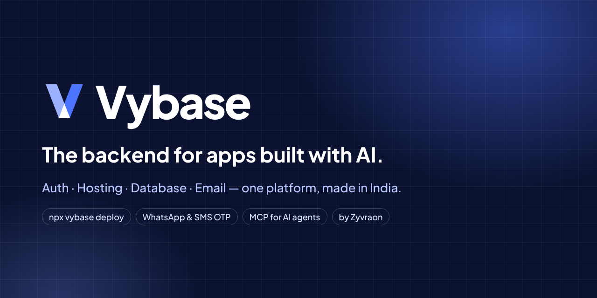

<p align="center"></p>

# vybase (Flutter / Dart)

Vybase Auth for Flutter, Android, iOS, web and Dart servers.

```yaml
dependencies:
  vybase:
    git:
      url: https://github.com/FZHAMZAALI/project-.git
      path: packages/sdk-flutter
```

```dart
import 'package:vybase/vybase.dart';

final zyv = Vybase(url: 'https://auth.zyvraone.site', key: 'pk_…', storage: SecureStorage());

await zyv.auth.signUp(email: email, password: password);
await zyv.auth.signInWithPassword(email: email, password: password);

// Email / SMS / WhatsApp code
await zyv.auth.signInWithOtp(phone: '+923001234567', channel: OtpChannel.whatsapp);
await zyv.auth.verifyOtp(phone: '+923001234567', code: code);

// Native Google sign-in (google_sign_in package)
final g = await GoogleSignIn(serverClientId: '<web client id>').signIn();
await zyv.auth.signInWithIdToken(idToken: (await g!.authentication).idToken!);

// Browser OAuth (Google / Vybase) with flutter_web_auth_2
final url = await zyv.auth.getOAuthSignInUrl(provider: OAuthProvider.zyvraon, redirectTo: 'com.myapp://callback');
final result = await FlutterWebAuth2.authenticate(url: url.toString(), callbackUrlScheme: 'com.myapp');
await zyv.auth.exchangeCodeForSession(Uri.parse(result).queryParameters['code']!);

zyv.auth.onAuthStateChange.listen((s) => print(s.event));
final user = await zyv.auth.getUser();
await zyv.auth.signOut();
```

Errors are thrown as `VybaseException` with a stable `code` (`email_taken`, `invalid_credentials`,
`otp_invalid`, `rate_limited`, `network_error`, …).

Keep the session across app launches by passing a `VybaseStorage` — see `lib/src/storage.dart` for a
`flutter_secure_storage` adapter. Add your app's scheme (e.g. `com.myapp://callback`) in the dashboard under
Auth → URL configuration.

Tests run against a real API: `VYBASE_TEST_URL=http://localhost:8787 VYBASE_TEST_ADMIN=dev dart test`.

---

**Vybase** is the backend for apps built with AI: auth, hosting, database and email in one platform.
Console: https://console.zyvraone.site · Docs for AI tools: https://auth.zyvraone.site/llms.txt · Built in India by [Zyvraon](https://api.zyvraone.site).

License: MIT
